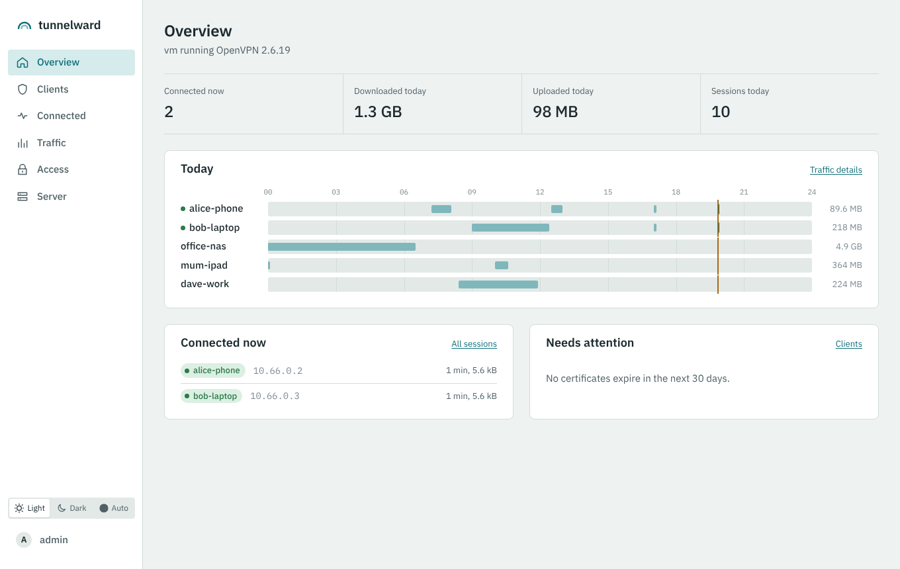
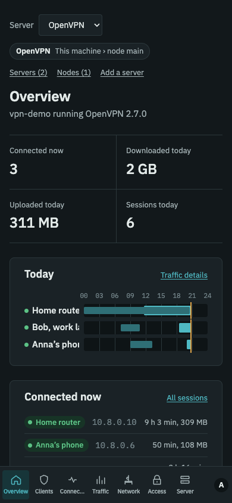
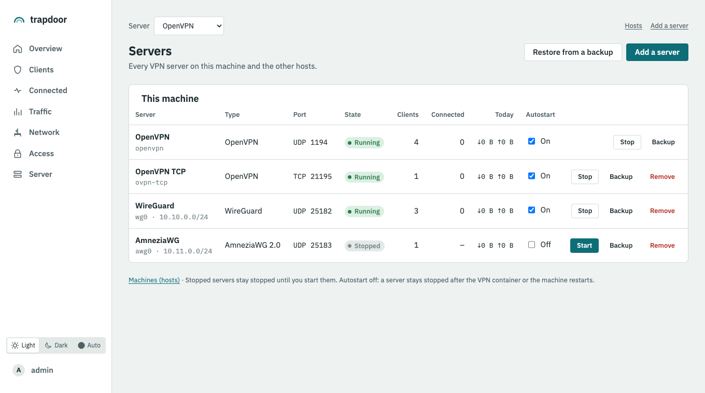
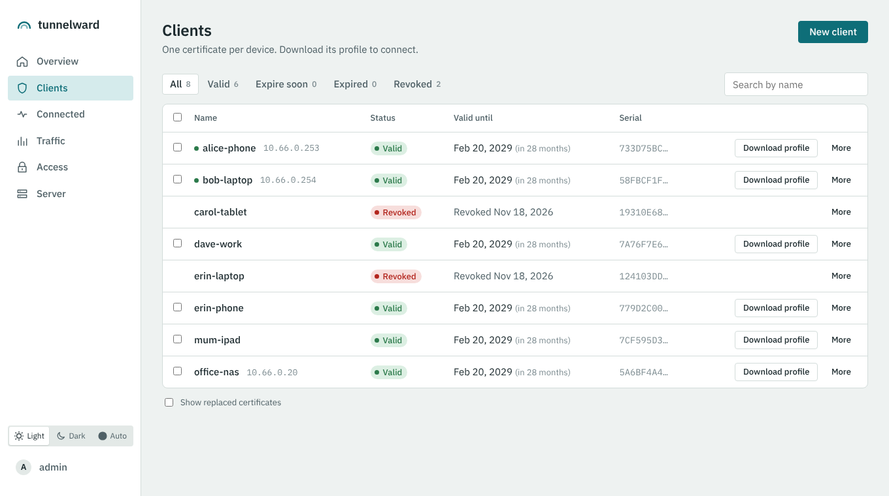
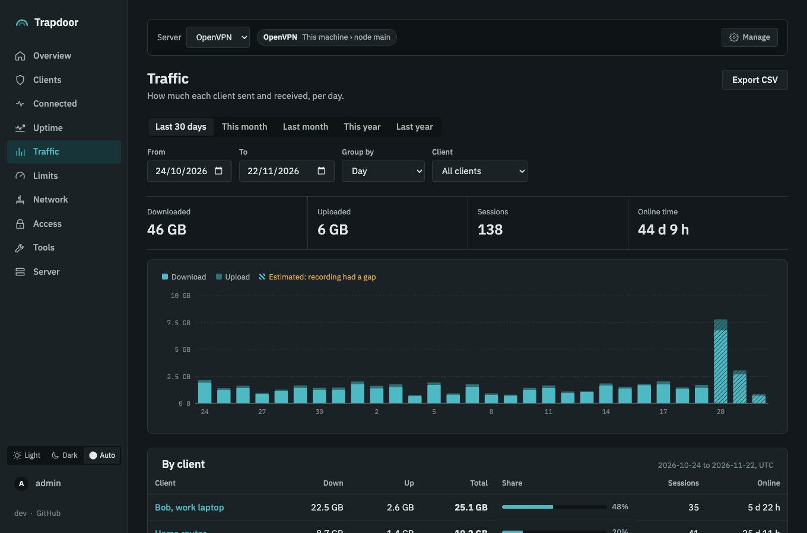

# trapdoor

[](https://github.com/shuricksumy/trapdoor/actions/workflows/ci.yml)
[](https://github.com/shuricksumy/trapdoor/actions/workflows/docker-publish.yml)
[](https://github.com/shuricksumy/trapdoor/actions/workflows/codeql.yml)
[](https://github.com/shuricksumy/trapdoor/releases)
[](LICENSE)

A web UI for your own OpenVPN, WireGuard and AmneziaWG servers: several of them, on one
machine or several. Set a server up in a few clicks, create a profile for every phone and
laptop, see who is connected and how much traffic each device used, decide which networks
each device may reach, and back it all up.

trapdoor is the successor to [openvpn-ui](https://github.com/shuricksumy/openvpn-ui) and
works with an existing openvpn-ui directory as it is: same certificates, same profiles,
same two-factor logins.

| Overview | Phone (dark theme) |
| --- | --- |
|  |  |

| Servers (all machines) |
| --- |
|  |

| Clients | Traffic | Access rules |
| --- | --- | --- |
|  |  |  |

## Features

**Servers**

- **OpenVPN, WireGuard and AmneziaWG** side by side, as many as you need (e.g. OpenVPN on UDP
  1194 and TCP 443, a WireGuard and an AmneziaWG server), on this machine and on other hosts
  from one web UI ([how](docs/guide.md#several-hosts))
- **Servers page**: every server on every machine with its state, clients, connected devices
  and today's traffic; start, stop, autostart on / off, backup, remove
- **Backup and restore**: one server (also to move it to another machine) or everything at
  once, optionally encrypted with a passphrase ([how](docs/guide.md#backup-and-restore))

**OpenVPN**

- **Setup** that creates the certificate authority, keys and `server.conf` with modern
  defaults (tls-crypt-v2, AES-GCM, TLS 1.2+) ([what it asks](docs/guide.md#setup))
- **Clients**: create, download the `.ovpn` profile, revoke, restore, renew (also in bulk),
  optional key passphrase; warnings before certificates expire
- **Two-factor login** per client with an authenticator app (QR code) and/or a static password
- **Connected now**: live sessions with traffic, disconnect a device
- **Traffic history** per client and for the whole server: any date range, by day, month or
  year, CSV export
- **Network per client**: fixed VPN address, routes, networks behind a client (site-to-site),
  all traffic through the VPN; named networks (e.g. "Office LAN") given to several clients at once;
  a Network page with what every client can reach
- **Access rules**: which client may reach which network or port; everything else allowed or
  blocked
- **Server settings** in a form or as raw `server.conf`, checked by OpenVPN before saving,
  with a preview of the changes, backups and restart with automatic rollback

**WireGuard and AmneziaWG**

- **Clients** with a QR code for the apps; add one or many at once, notes, your own address,
  the device's own key if you prefer, per-client DNS, allowed IPs, MTU and keepalive
  ([how](docs/guide.md#wireguard-servers))
- **AmneziaWG** hides the VPN from blocking: obfuscation levels 1.5, 2.0 (default) and 3.1,
  random values within the AmneziaWG limits; no kernel module needed in Docker
- Live state from the interface, traffic history and access rules as for OpenVPN
- Changes apply without disconnecting anybody (`wg syncconf`)

**Everywhere**

- Light / dark / auto theme, works on phones
- Secure by design: the web UI has no privileges, admin passwords are hashed, login attempts
  are throttled, no external scripts or CDNs

## Quick start (Docker)

You need a Linux server with Docker and a UDP port reachable from the internet (one per VPN
server; the compose file publishes OpenVPN UDP 1194, a second OpenVPN on TCP 1195, WireGuard
UDP 51820 and AmneziaWG UDP 51830 by default).

```bash
mkdir trapdoor && cd trapdoor
curl -fsSLO https://raw.githubusercontent.com/shuricksumy/trapdoor/main/docker-compose.yml
curl -fsSL -o .env https://raw.githubusercontent.com/shuricksumy/trapdoor/main/.env.example
sed -i "s/^TD_AGENT_TOKEN=.*/TD_AGENT_TOKEN=$(openssl rand -hex 32)/" .env
nano .env                                    # time zone (TD_TZ), VPN port; the rest can stay
docker compose up -d
docker compose exec -it web trapdoor user add admin    # choose your admin password
```

1. Open the web UI. It listens on `127.0.0.1:8080` of the server, so either put it behind
   your reverse proxy ([below](#reverse-proxy)) or, for a first look, open an SSH tunnel:
   `ssh -L 8080:127.0.0.1:8080 <server>` and browse to http://localhost:8080.
2. Log in. The setup opens: enter the address clients connect to (a hostname or your public
   IP), pick the options and press **Create the server**.
3. Forward the VPN port (`VPN_PORT`, UDP 1194 by default) from your router or cloud firewall
   to this server.
4. **Clients → New client**, then **Download profile** and import it in the OpenVPN app on the
   device (OpenVPN Connect, Tunnelblick, network-manager-openvpn, …).
5. More servers: **Add a server** (top right) for WireGuard, AmneziaWG or another OpenVPN
   server; forward its port too. Other machines: **Hosts**
   ([how](docs/guide.md#several-hosts)).

## Moving from openvpn-ui

trapdoor reads openvpn-ui's directory as it is (`server.conf`, `client-template.txt`,
`easy-rsa/pki`, `ccd/`): certificates, profiles, routes and two-factor logins keep working.

1. Back up the directory.
2. Stop the openvpn-ui containers.
3. In `.env` set `OPENVPN_DIR` to that directory, then `docker compose up -d` and create an
   admin as above.
4. Check that `server.conf` has a `management` line (openvpn-ui's `management 0.0.0.0 2080`
   works; `127.0.0.1 2080` is better). The Server page points out anything missing.

Admin users are not taken over: create them with `trapdoor user add`.

## Reverse proxy

Put the web UI behind HTTPS. With **Traefik** use the ready-made override:

```bash
curl -fsSLO https://raw.githubusercontent.com/shuricksumy/trapdoor/main/docker-compose.traefik.yml
# in .env: COMPOSE_FILE=docker-compose.yml:docker-compose.traefik.yml, TD_HOSTNAME, TRAEFIK_NETWORK
docker compose up -d
```

It removes the host port, joins your Traefik network and adds the router labels; adjust the
entrypoint, certificate resolver and middlewares (an Authelia line is included, commented
out) in the file. With **Caddy, nginx** or anything else, proxy to `WEB_BIND` and set
`TD_TRUSTED_PROXIES` to the proxy's address so login throttling sees real client IPs.

## Updating

```bash
docker compose pull && docker compose up -d
```

**Coming from a version with an `openvpn` service** (compose files before November 2026): the
service is now called `vpn`. Take the new `docker-compose.yml` (keep your `.env`), then run
`docker compose up -d --remove-orphans` once: it replaces the old `openvpn` container, which
would otherwise keep the VPN ports. Your files stay where they are. A compose file you keep
with the old name works too.

The `agent` container uses the network of the `vpn` container. After restarting
`vpn` on its own, restart `agent` too (`docker compose restart agent`), otherwise the
agent cannot reach OpenVPN; `docker compose up -d` handles this by itself.

Images on GitHub Container Registry, `ghcr.io/shuricksumy/trapdoor` (amd64 and arm64):

| Tag | Built from |
| --- | --- |
| `latest` | the `main` branch |
| `1.2.3`, `1.2` | releases (set `TD_IMAGE=ghcr.io/shuricksumy/trapdoor:1.2` in `.env` for a stable setup) |

## Backups

Every server's page has *Backup* for that server alone (keys, clients, settings, history);
*Add a server → From a backup* restores it, also on another machine.

Account → Backup downloads one file with everything: the certificate authority and client
keys, server settings, WireGuard and AmneziaWG servers, access rules, admins, traffic
history and the other hosts. Give it a passphrase: the file is then encrypted (it holds your
CA keys). Restore on a fresh machine, with trapdoor stopped:

```bash
docker compose run --rm --no-deps -v ./trapdoor-backup.tdbackup:/b:ro --entrypoint trapdoor vpn restore agent /b
docker compose run --rm --no-deps -v ./trapdoor-backup.tdbackup:/b:ro web restore web /b
docker compose up -d
```

Details (other hosts, `--force`, without Docker) are in the [guide](docs/guide.md#backup-and-restore).

## Settings

Set in `.env` next to `docker-compose.yml`:

| Variable | Default | Meaning |
| --- | --- | --- |
| `TD_AGENT_TOKEN` | — | Shared secret between the web UI and the agent; required, long and random |
| `TD_TZ` | `UTC` | Time zone for days, months and years in traffic reports, e.g. `Europe/Berlin` |
| `OPENVPN_DIR` | `./openvpn` | OpenVPN directory on the host |
| `VPN_PORT` / `VPN_PROTO` | `1194` / `udp` | Port and protocol published for the first OpenVPN server |
| `VPN2_PORT` / `VPN2_PROTO` | `1195` / `tcp` | A second OpenVPN server (the same port inside and outside) |
| `WIREGUARD_DIR` / `WG_PORT` | `./wireguard` / `51820` | WireGuard servers' files on the host, and the UDP port published for them |
| `AMNEZIAWG_DIR` / `AWG_PORT` | `./amneziawg` / `51830` | The same for AmneziaWG |
| `VPN_NAT_SUBNET` | `auto` | NAT for VPN clients: `auto` follows `server.conf`, or a subnet, or empty for none |
| `WEB_BIND` | `127.0.0.1:8080` | Where the web UI listens on the host |
| `TD_COOKIE_SECURE` | `true` | `false` only for testing over plain HTTP |
| `TD_TRUSTED_PROXIES` | — | Reverse proxy addresses (CIDRs) allowed to pass the client IP |
| `TD_WEB_API_TOKEN` | — | Optional token for scripts: `Authorization: Bearer …` ([API](docs/api.md)) |
| `TD_EXPIRY_WARN_DAYS` | `30` | Warn this many days before a client certificate expires |
| `TD_SESSION_IDLE` | `12h` | Admin logout after this much inactivity |
| `TD_TOTP_ISSUER` | `trapdoor` | Name shown in authenticator apps |
| `TD_IMAGE` | `…/trapdoor:latest` | Image to run |

## Without Docker

Each [release](https://github.com/shuricksumy/trapdoor/releases) has Linux binaries
(amd64, arm64, armv7) with the web UI built in. Run `trapdoor agent` as root next to
OpenVPN (and `wireguard-tools` / `amneziawg-tools` for those servers) and `trapdoor web` as
an unprivileged user, with the same `TD_AGENT_TOKEN`; see
[docs/guide.md](docs/guide.md#admin-login-and-security) for how the parts fit together and
[`internal/config/config.go`](internal/config/config.go) for every setting.

## Documentation

- [How trapdoor works](docs/guide.md): setup, profiles, two-factor login, server
  settings, client networks and named networks, access rules, traffic history, more OpenVPN
  servers, WireGuard and AmneziaWG, the Servers page, several hosts, backup and restore,
  security
- [HTTP API](docs/api.md)
- [Development](docs/development.md): building, tests, GitHub Actions, releases
- [Roadmap](ROADMAP.md)

## License

[MIT](LICENSE)
