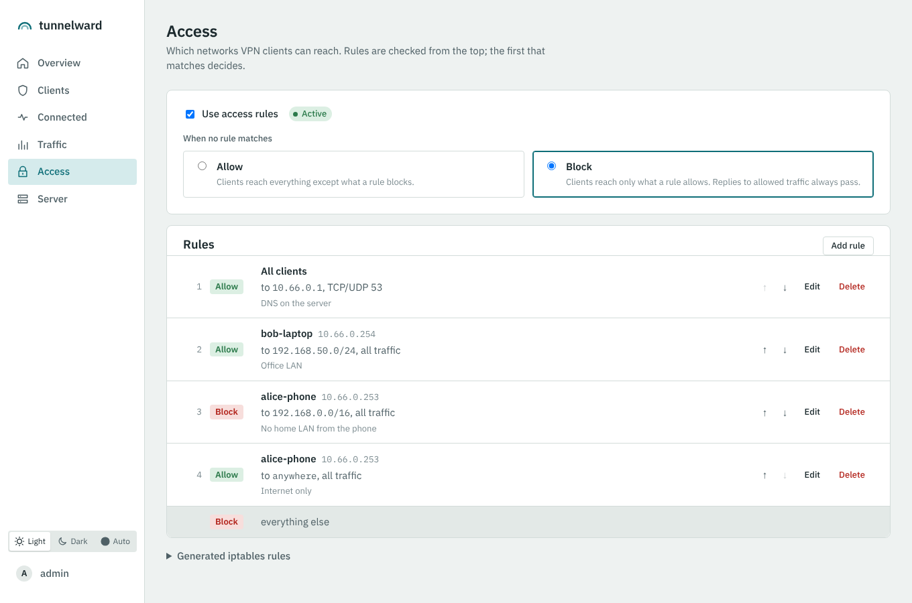

# tunnelward

[](https://github.com/shuricksumy/tunnelward/actions/workflows/ci.yml)
[](https://github.com/shuricksumy/tunnelward/actions/workflows/docker-publish.yml)
[](https://github.com/shuricksumy/tunnelward/actions/workflows/codeql.yml)
[](https://github.com/shuricksumy/tunnelward/releases)
[](LICENSE)

A web UI for your own OpenVPN server. Set the server up in a few clicks, create a profile
for every phone and laptop, see who is connected and how much traffic each device used,
and decide which networks each device may reach.

tunnelward is the successor to [openvpn-ui](https://github.com/shuricksumy/openvpn-ui) and
works with an existing openvpn-ui directory as it is: same certificates, same profiles,
same two-factor logins.

| Overview | Phone (dark theme) |
| --- | --- |
|  |  |

| Clients | Traffic | Access rules |
| --- | --- | --- |
|  |  |  |

## Features

- **Setup** that creates the certificate authority, keys and `server.conf` with modern
  defaults (tls-crypt-v2, AES-GCM, TLS 1.2+) ([what it asks](docs/guide.md#setup))
- **Clients**: create, download the `.ovpn` profile, revoke, restore, renew (also in bulk),
  optional key passphrase; warnings before certificates expire
- **Two-factor login** per client with an authenticator app (QR code) and/or a static password
- **Connected now**: live sessions with traffic, disconnect a device
- **Traffic history** per client and for the whole server: any date range, by day, month or
  year, CSV export
- **Network per client**: fixed VPN address, routes, networks behind a client (site-to-site),
  all traffic through the VPN
- **Access rules**: which client may reach which network or port; everything else allowed or
  blocked
- **Server settings** in a form or as raw `server.conf`, checked by OpenVPN before saving,
  with a preview of the changes, backups and restart with automatic rollback
- Light / dark / auto theme, works on phones
- Secure by design: the web UI has no privileges, admin passwords are hashed, login attempts
  are throttled, no external scripts or CDNs

## Quick start (Docker)

You need a Linux server with Docker and a UDP port reachable from the internet.

```bash
mkdir tunnelward && cd tunnelward
curl -fsSLO https://raw.githubusercontent.com/shuricksumy/tunnelward/main/docker-compose.yml
curl -fsSL -o .env https://raw.githubusercontent.com/shuricksumy/tunnelward/main/.env.example
sed -i "s/^TW_AGENT_TOKEN=.*/TW_AGENT_TOKEN=$(openssl rand -hex 32)/" .env
nano .env                                    # time zone (TW_TZ), VPN port; the rest can stay
docker compose up -d
docker compose exec -it web tunnelward user add admin    # choose your admin password
```

1. Open the web UI. It listens on `127.0.0.1:8080` of the server, so either put it behind
   your reverse proxy ([below](#reverse-proxy)) or, for a first look, open an SSH tunnel:
   `ssh -L 8080:127.0.0.1:8080 <server>` and browse to http://localhost:8080.
2. Log in. The setup opens: enter the address clients connect to (a hostname or your public
   IP), pick the options and press **Create the server**.
3. Forward the VPN port (`VPN_PORT`, UDP 1194 by default) from your router or cloud firewall
   to this server.
4. **Clients → New client**, then **Download profile** and import it in the OpenVPN app on the
   device (OpenVPN Connect, Tunnelblick, network-manager-openvpn, …).

## Moving from openvpn-ui

tunnelward reads openvpn-ui's directory as it is (`server.conf`, `client-template.txt`,
`easy-rsa/pki`, `ccd/`): certificates, profiles, routes and two-factor logins keep working.

1. Back up the directory.
2. Stop the openvpn-ui containers.
3. In `.env` set `OPENVPN_DIR` to that directory, then `docker compose up -d` and create an
   admin as above.
4. Check that `server.conf` has a `management` line (openvpn-ui's `management 0.0.0.0 2080`
   works; `127.0.0.1 2080` is better). The Server page points out anything missing.

Admin users are not taken over: create them with `tunnelward user add`.

## Reverse proxy

Put the web UI behind HTTPS. With **Traefik** use the ready-made override:

```bash
curl -fsSLO https://raw.githubusercontent.com/shuricksumy/tunnelward/main/docker-compose.traefik.yml
# in .env: COMPOSE_FILE=docker-compose.yml:docker-compose.traefik.yml, TW_HOSTNAME, TRAEFIK_NETWORK
docker compose up -d
```

It removes the host port, joins your Traefik network and adds the router labels; adjust the
entrypoint, certificate resolver and middlewares (an Authelia line is included, commented
out) in the file. With **Caddy, nginx** or anything else, proxy to `WEB_BIND` and set
`TW_TRUSTED_PROXIES` to the proxy's address so login throttling sees real client IPs.

## Updating

```bash
docker compose pull && docker compose up -d
```

Images on GitHub Container Registry, `ghcr.io/shuricksumy/tunnelward` (amd64 and arm64):

| Tag | Built from |
| --- | --- |
| `latest` | the `main` branch |
| `1.2.3`, `1.2` | releases (set `TW_IMAGE=ghcr.io/shuricksumy/tunnelward:1.2` in `.env` for a stable setup) |

## Backups

Everything that matters is in two places:

- **`OPENVPN_DIR`** (default `./openvpn`): the certificate authority and all client keys,
  `server.conf`, per-client settings. Losing it means re-issuing every profile, so back it up
  and keep it private.
- **The `web-data` volume**: admin users and traffic history.
  `docker compose stop web && docker compose cp web:/data/tunnelward.db ./tunnelward.db && docker compose start web`

## Settings

Set in `.env` next to `docker-compose.yml`:

| Variable | Default | Meaning |
| --- | --- | --- |
| `TW_AGENT_TOKEN` | — | Shared secret between the web UI and the agent; required, long and random |
| `TW_TZ` | `UTC` | Time zone for days, months and years in traffic reports, e.g. `Europe/Berlin` |
| `OPENVPN_DIR` | `./openvpn` | OpenVPN directory on the host |
| `VPN_PORT` / `VPN_PROTO` | `1194` / `udp` | Port and protocol published for VPN clients |
| `VPN_NAT_SUBNET` | `auto` | NAT for VPN clients: `auto` follows `server.conf`, or a subnet, or empty for none |
| `WEB_BIND` | `127.0.0.1:8080` | Where the web UI listens on the host |
| `TW_COOKIE_SECURE` | `true` | `false` only for testing over plain HTTP |
| `TW_TRUSTED_PROXIES` | — | Reverse proxy addresses (CIDRs) allowed to pass the client IP |
| `TW_WEB_API_TOKEN` | — | Optional token for scripts: `Authorization: Bearer …` ([API](docs/api.md)) |
| `TW_EXPIRY_WARN_DAYS` | `30` | Warn this many days before a client certificate expires |
| `TW_SESSION_IDLE` | `12h` | Admin logout after this much inactivity |
| `TW_TOTP_ISSUER` | `tunnelward` | Name shown in authenticator apps |
| `TW_IMAGE` | `…/tunnelward:latest` | Image to run |

## Without Docker

Each [release](https://github.com/shuricksumy/tunnelward/releases) has Linux binaries
(amd64, arm64, armv7) with the web UI built in. Run `tunnelward agent` as root next to
OpenVPN and `tunnelward web` as an unprivileged user, with the same `TW_AGENT_TOKEN`; see
[docs/guide.md](docs/guide.md#admin-login-and-security) for how the parts fit together and
[`internal/config/config.go`](internal/config/config.go) for every setting.

## Documentation

- [How tunnelward works](docs/guide.md): setup, profiles, two-factor login, server
  settings, client networks, access rules, traffic history, security
- [HTTP API](docs/api.md)
- [Development](docs/development.md): building, tests, GitHub Actions, releases
- [Roadmap](ROADMAP.md)

## License

[MIT](LICENSE)
