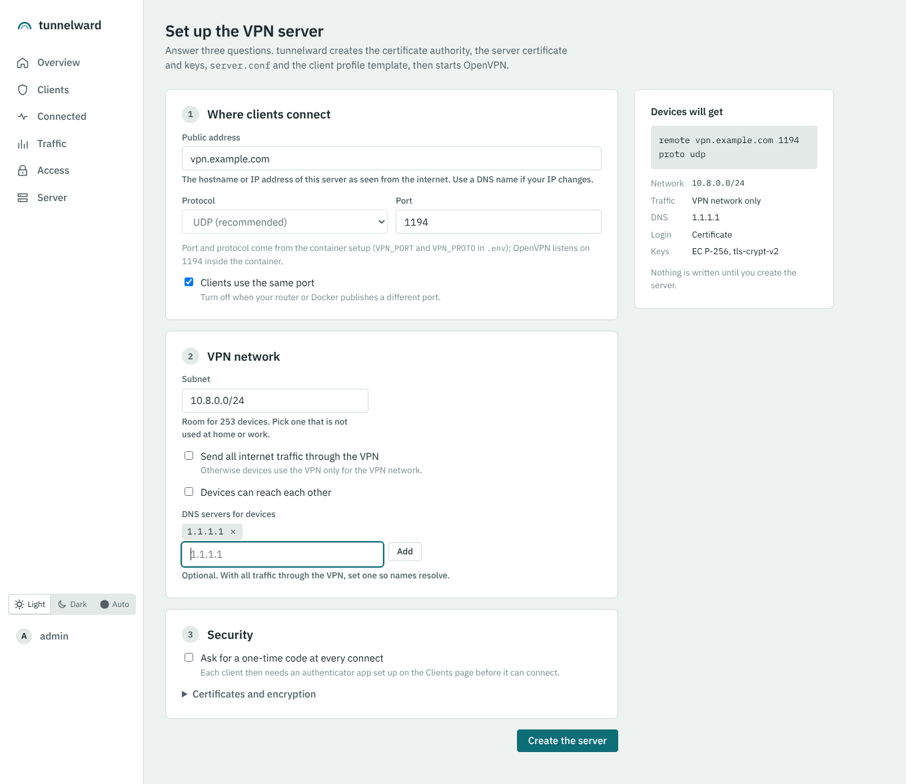
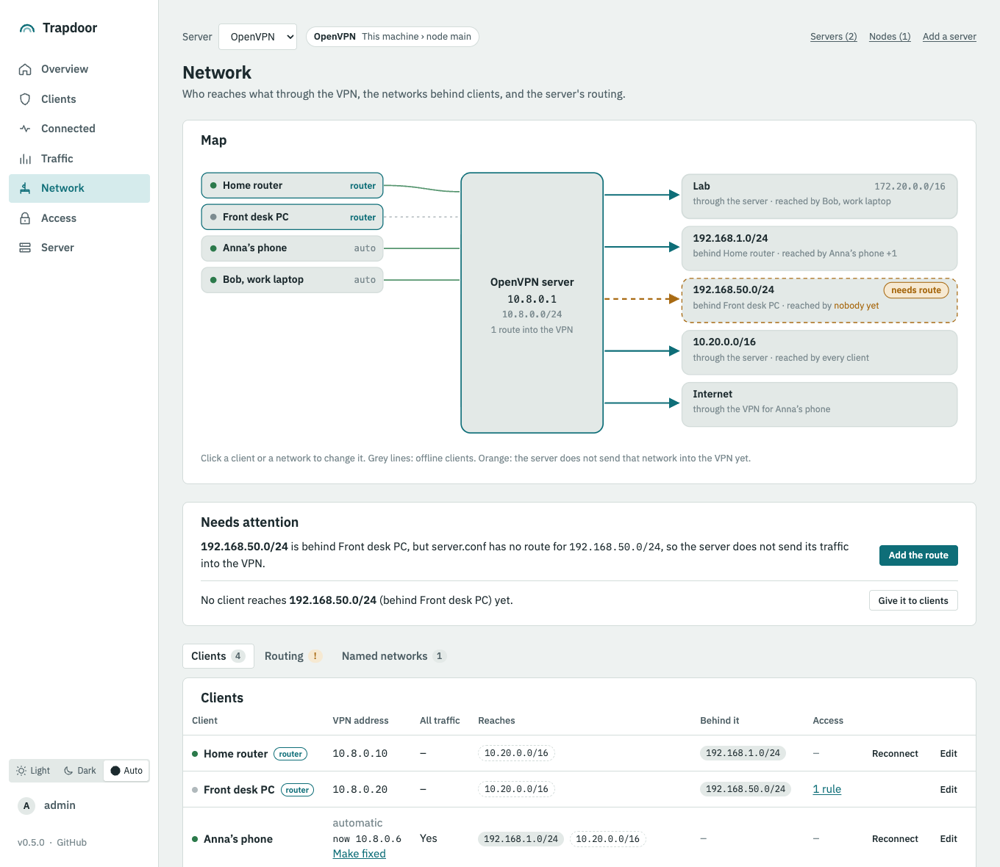
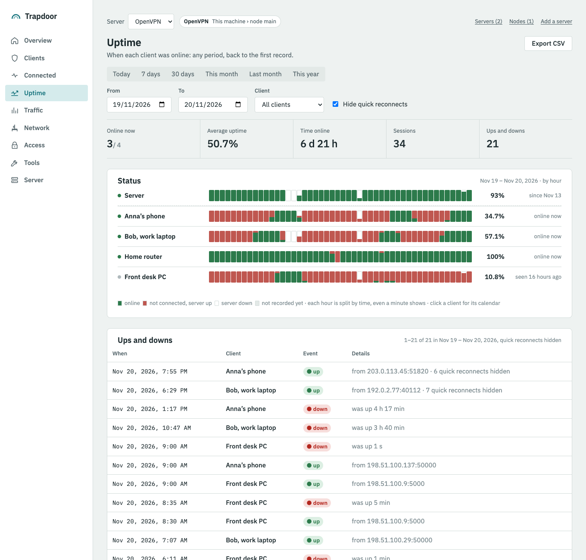
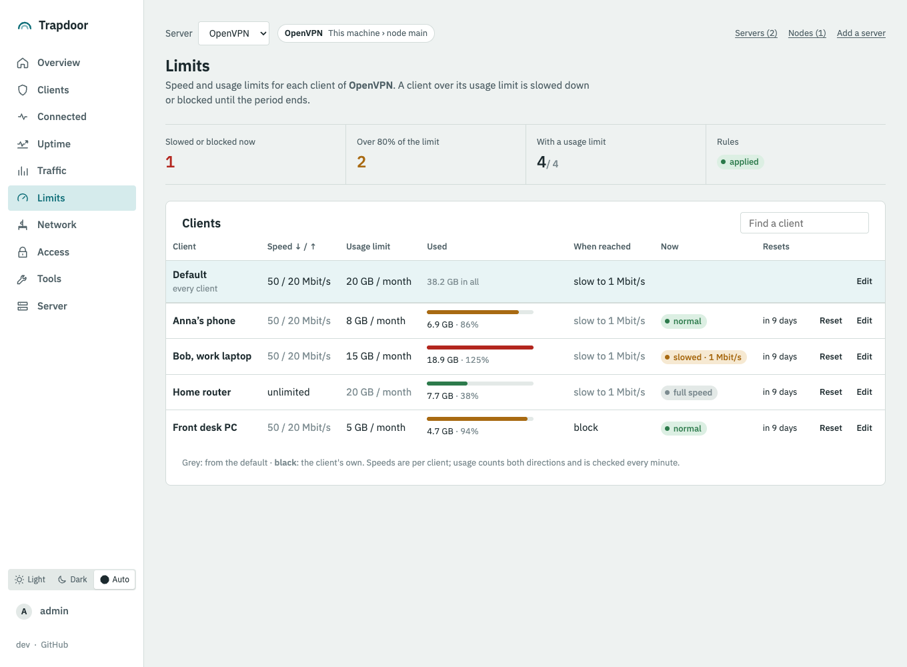
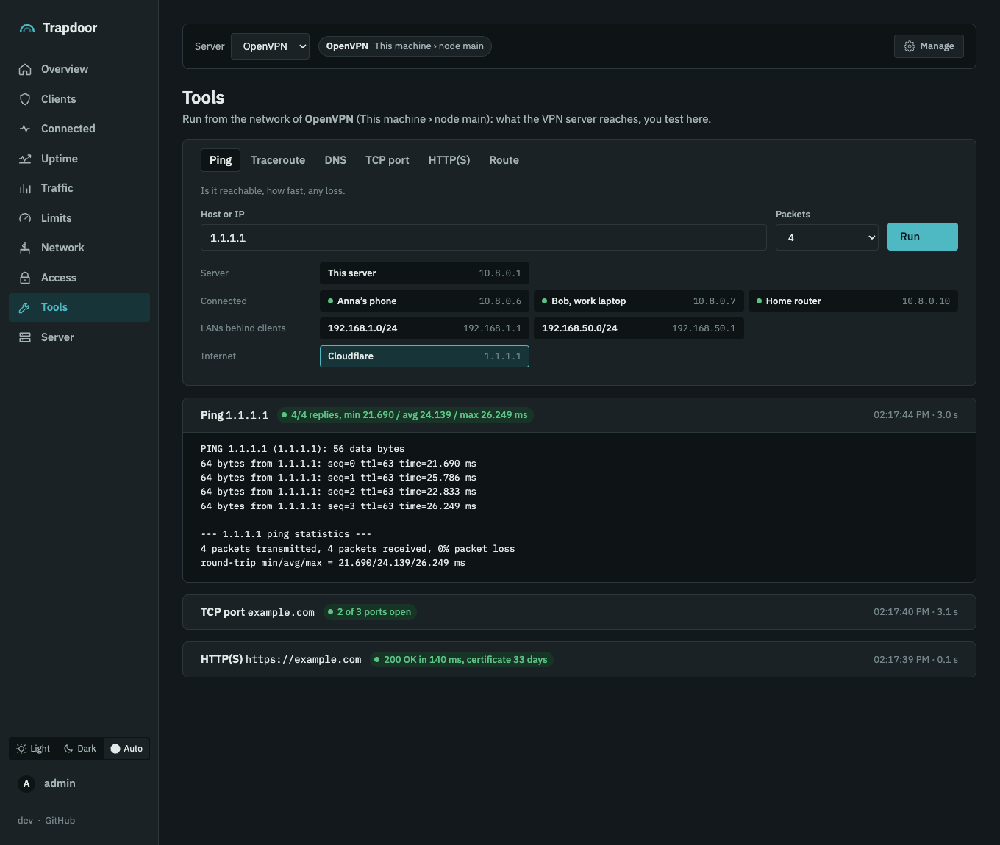

# How trapdoor works

Details behind the pages of the web UI. For installing, see the [README](../README.md);
for the HTTP API, [api.md](api.md).

- [Setup](#setup)
- [Client profiles](#client-profiles)
- [Client two-factor login](#client-two-factor-login)
- [Server configuration](#server-configuration)
- [OpenVPN 2.7](#openvpn-27)
- [Expiring certificates](#expiring-certificates)
- [Client network settings](#client-network-settings)
- [Access rules](#access-rules)
- [Traffic history](#traffic-history)
- [WireGuard servers](#wireguard-servers)
- [AmneziaWG servers](#amneziawg-servers)
- [Admin login and security](#admin-login-and-security)

## Setup



On a server without `server.conf` the web UI opens the setup after login. It asks for the
public address, protocol and port, the VPN subnet, full or split tunnel, DNS and two-factor
login, then creates the certificate authority (EC P-256 by default; P-384 and RSA are in
"Certificates and encryption"), the `server` certificate, the control channel key
(tls-crypt-v2 by default), `server.conf` and `client-template.txt`, and waits for OpenVPN to
start. Nothing is overwritten: an existing PKI is reused, and the setup refuses when
`server.conf` exists.

In Docker OpenVPN listens on 1194 inside the container; `VPN_PORT` / `VPN_PROTO` in `.env`
set what is published and what client profiles use. `VPN_NAT_SUBNET=auto` (default)
masquerades the `server` subnet of `server.conf` and follows it when it changes.

The generated `server.conf` drops OpenVPN's privileges (`user nobody`), checks the CRL at
every connect, allows TLS 1.2+ with AES-GCM / ChaCha20 data ciphers, and keeps the
management interface on 127.0.0.1.

## Moving from openvpn-ui

openvpn-ui's directory works as trapdoor's `TD_OPENVPN_DIR` with a few edits. Do them on a
copy, start trapdoor on it next to the old server (other ports, or another machine), and
switch when the checks below pass; going back is starting openvpn-ui on the untouched
original.

**`server.conf`**

| openvpn-ui | trapdoor |
|---|---|
| `auth-user-pass-verify /opt/scripts/auth_client.sh via-file` | `auth-user-pass-verify "/usr/local/bin/trapdoor auth-verify --ccd /etc/openvpn/ccd" via-file` |
| `port <old port>` | `port 1194`, and `VPN_PORT` / `VPN_PROTO` = the old port and protocol: profiles keep `remote … <old port>` |
| `ncp-ciphers …` | `data-ciphers …` (removed in OpenVPN 2.7) |
| `log /etc/openvpn/openvpn.log` | optional: without it OpenVPN logs to the `vpn` container (`docker compose logs vpn`) |
| `management 0.0.0.0 2080` | `management 127.0.0.1 2080` (both work) |

The rest stays: `dev tun5` or other names, relative paths (`ca ca.crt`: OpenVPN runs in
the directory), `user nobody` / `group nogroup`, `client-to-client`, pushed routes and DNS.
`crl-verify crl.pem` is kept current: trapdoor copies the CRL there after every revoke
(`TD_CRL_COPIES`).

**Not needed any more:** openvpn-ui's `set_fw.sh` / `rm_fw.sh` (the `vpn` container does NAT
for the server subnet, `VPN_NAT_SUBNET=auto`), its SQL dumps, `.bac` copies and old
`clients/*.ovpn` exports, and a copy of `ca.key` next to `server.conf` if there is one (the
CA key is in `easy-rsa/pki/private/`). Its database is not read: admins are created again;
openvpn-ui's routes come over as the `ccd` lines (create named networks for them if you
like).

**Logins:** `#STATIC_PASS:` and `#2FA_KEY:` in `ccd` work unchanged. A client with neither
must send an empty password; give it a static password if its device sends one.

**Docker network:** if openvpn-ui's container was on a network that clients reach (e.g.
pushed `route 172.20.0.0 …` or a DNS server there), add that network to the `vpn` service:

```yaml
services:
  vpn:
    networks: [default, proxy]
networks:
  proxy:
    external: true
    name: <the network's name>
```

**Checks before switching**

- Clients: the same names, the revoked ones revoked, expiry dates as before.
- Client → Network: fixed address, routes, LANs behind it as in its `ccd` file.
- A profile downloaded from trapdoor has the same `<ca>`, `<cert>`, `<key>` as openvpn-ui's;
  only template lines may differ (trapdoor uses the current `client-template.txt`).
- A real client connects with its old profile and password (point its `remote` at the test
  server in a copy of the profile); a wrong password is refused.

Then make a backup in trapdoor (Account → Backup, with a passphrase) and restore it on the
production machine (`trapdoor restore`, see [Backup and restore](#backup-and-restore)), or
copy the edited directory there.

## Display names

A client's certificate name (`anna`) is its login and cannot change, but it can have a
display name ("Anna's phone"): set it in *New client* or later with Clients → More →
*Display name*. Every page shows it instead of the login: the client list (with the login
next to it; search finds both), the Overview, Connected, Traffic, Network and Access (the
login in the tooltip). Clients without one show their login. CSV exports and the API keep
the login. It is a `#TD_NOTE:` line in the client's `ccd` file, next to the
network and two-factor lines, so it moves with the server, its backups and copies;
OpenVPN and openvpn-ui ignore it. One line, at most 200 characters.

## Client profiles

`.ovpn` files are built like openvpn-ui did, so existing servers produce the same files:
`<TD_OPENVPN_DIR>/client-template.txt` + inline `<ca>`, `<cert>`, `<key>` + the
control-channel key matching `server.conf` (`tls-crypt`, `tls-auth` with `key-direction 1`,
or a per-client `tls-crypt-v2` key). tls-crypt-v2 client keys live in `keys-v2/<name>.key`;
existing ones are reused, new ones are created with `openvpn --genkey` (`TD_OPENVPN_BIN`).

## Client two-factor login

Per client, in the UI (Clients → More → Two-factor login) or `PUT /api/v1/servers/openvpn/certs/{name}/auth`:
an authenticator code (TOTP, HMAC-SHA256, 6 digits, 30 s) and/or a static password. The
device logs in with username = its certificate name and password = static password followed
by the code. OpenVPN checks it with trapdoor:

```
# server.conf
script-security 2
auth-user-pass-verify "/usr/local/bin/trapdoor auth-verify" via-file
# client-template.txt
auth-user-pass
```

The settings live in `ccd/<name>` exactly as openvpn-ui wrote them (`#2FA_KEY:` hex secret,
`#2FA_USER:`, `#STATIC_PASS:`), so existing enrolments keep working without `oathtool` or
`auth_client.sh`. Differences from openvpn-ui's script:

- the username must match the certificate: one client's password and code cannot be used with
  another client's certificate (the old script allowed that)
- new static passwords are stored hashed (`#STATIC_PASS_HASH:`); old plain ones still work
- codes from the previous and next 30-second step are accepted (clock drift)
- other lines in `ccd/<name>` (routes, `ifconfig-push`) are never touched; deleting the client
  deletes its `ccd` file

Use an authenticator app that supports SHA-256 codes (some apps only do SHA-1).

## Server configuration

The Server page is in sections, each with its own settings and its own Save: the server's
settings, scripts and extra rules, backup, removing it (WireGuard / AmneziaWG: connection, hiding,
client defaults too). They are folded, with what is set now in the header; the browser remembers
which ones were left open.

**Server** page (or `/api/v1/servers/openvpn/server/config`): a form for the common options (port, protocol,
VPN subnet, topology, DNS and search domain for clients, duplicate-cn, max clients) and a raw
editor for the whole `server.conf`. Every other line and comment in the file is kept. Routing
(full tunnel, client-to-client, server routes, routes pushed to everyone) is on the
[Network](#the-network-page) page.

- Before saving, the config is checked: OpenVPN itself parses it, plus trapdoor's checks
  (values OpenVPN only checks at startup, referenced key/cert files and directories exist,
  missing `management` / `crl-verify` / `client-config-dir` are pointed out)
- A preview shows exactly which lines change; saving keeps a backup (last 10, in
  `trapdoor-backups/`) and is refused if the file changed in the meantime
- "Networks behind clients" offers the LANs set on clients that still lack a `route` line
- **Apply and restart** restarts OpenVPN through the management interface and waits for it;
  if it does not come back within 30 s, the config it ran with before is restored and it is
  started again
- Restart method `TD_OPENVPN_RESTART`: `SIGHUP` (default; OpenVPN re-reads its config) or
  `SIGTERM` when a supervisor starts it again — the Docker image's `vpn` service does
  that inside the same container, so the agent keeps its shared network

## OpenVPN 2.7

The Docker image runs OpenVPN 2.7 (from Alpine). Configs written for 2.6 keep working,
with one change to look at before updating an existing server:

- **Topology:** a `server.conf` without a `topology` line used `net30` up to 2.6 and uses
  `subnet` from 2.7 on. Clients then get addresses from a different scheme, and fixed
  addresses in `ccd/` written for `net30` stop matching. The Server page warns about a
  missing `topology` line: before updating, add `topology net30` to keep the old
  behaviour (or move to `topology subnet` on purpose). Configs made by trapdoor's setup
  always have `topology subnet`. trapdoor follows the installed OpenVPN for the default.
- **Compression:** OpenVPN 2.7 no longer compresses what it sends; `comp-lzo` / `compress`
  only keep receiving compressed packets working, with a warning. Old clients still
  connect.
- `persist-key` is always on now (the option prints a notice); `ncp-disable` was already
  removed in 2.6.

Updating the image on your server: `docker compose pull && docker compose up -d`. The
Overview shows the running OpenVPN version.

## Expiring certificates

A client certificate is valid for 825 days unless chosen otherwise. *New client* offers 30
days to 10 years or *Until a date…* (e.g. a guest until Sunday: the certificate's end is the
client's end date). Each OpenVPN server can have its own lifetime for new and renewed
certificates (*Use this for new clients and renewals on this server* in *New client*, or
`PUT /api/v1/servers/{server}/cert-defaults {"validity_days": 3650}`); the renew dialogs
start with it.

- Client certificates expiring within `TD_EXPIRY_WARN_DAYS` (default 30) are flagged in the UI
  and logged by the web process at start and once a day; the CA is flagged 90 days ahead
  (when it expires, every client stops working at once).
- Clients → select several (or "Select them" on the banner) → **Renew selected**, or
  `POST /api/v1/servers/openvpn/certs/renew {"names":[…],"validity_days":…}` with a result per name.
- Renewing keeps each key; a client's old certificate is revoked, so every renewed device
  needs its new profile.
- Renewing the **server** certificate keeps the old one valid (moved to `renewed/issued/`, as
  easyrsa does): OpenVPN uses it until it is restarted with the new one.

Long tables (Clients, Connected → recently disconnected, Traffic → by client, Limits, the
Network page's clients) show 15 rows per page; *Rows* under a table switches to 25, 50 or 100,
and the browser remembers it for every table.

## Client network settings

Per client, in the UI (Clients → More → Network) or `PUT /api/v1/servers/openvpn/certs/{name}/network`:

| Setting | Written to `ccd/<name>` |
|---|---|
| static VPN address | `ifconfig-push 10.8.0.50 255.255.255.0` (net30: the /30 peer address) |
| networks the client can reach | `push "route 192.168.1.0 255.255.255.0"` |
| networks behind the client (site-to-site) | `iroute 192.168.50.0 255.255.255.0` |
| all traffic through the VPN | `push "redirect-gateway def1"` |

Addresses are checked against `server` / `topology` in `server.conf` and against the other
clients' static addresses. A LAN behind a client also needs `route <net> <mask>` in
`server.conf`: the Network page offers to add it. `server.conf` needs
`client-config-dir ccd`. Changes apply when the client reconnects (the UI offers to reconnect
it). The 2FA lines and any other lines in the file are kept; openvpn-ui's files are read as they are.

### Named networks

A named network is a set of networks with a name, like openvpn-ui's routes: e.g.
"Office LAN" = `192.168.50.0/24`, behind the client `office-gw`, reachable for `laptop`
and `phone`. Manage them under Clients → Named networks, or with
`PUT /api/v1/servers/{server}/named-networks/{name}`.

- They are kept in `trapdoor-networks.json` next to `server.conf`. Their routes are
  written into the ccd files like the client's own: `push "route …"` for the clients that
  reach them, `iroute …` for the client they are behind. Nothing changes for OpenVPN.
- Changing or removing a network updates every client that has it; each client's own
  routes stay. A change that would make any client's file invalid (e.g. a network inside the
  VPN subnet behind a client) is refused as a whole.
- A client's Network dialog shows its named networks as chips next to its own routes:
  remove one, or pick *Add a named network…* (reach it) / *…behind this client*; that
  changes the named network right away, for this client.
- Behind a client, the server needs a `route` line for the networks, as for a LAN set on
  the client: the Network page offers to add it.

### The Network page

Everything about routing is on one page (menu → Network), the same for every server type:



- **Map**: clients on the left (routers first, online ones with a green line), the server in
  the middle, the networks on the right: each one through the server or behind a client,
  with who reaches it ("every client", names, or "nobody yet"), and the internet (which
  clients send all traffic through the VPN). A LAN behind a client without a server `route`
  is orange with *needs route* (not with `client-to-client`: OpenVPN then carries client
  traffic to it without one). Click a client or a network to edit it. On phones the
  networks are a list.
- **Needs attention**, each with a button: a LAN behind a client without a server route
  (*Add the route* writes `route <net> <mask>` into `server.conf`, checked and backed up like
  the Server page), a LAN nobody reaches (*Give it to clients*; WireGuard: *Give it to every
  client* adds it to the default allowed IPs), LANs behind two clients that overlap, a server
  route no client has behind it. Saved `server.conf` changes show *Apply and restart*: every
  client reconnects, and the previous config comes back if OpenVPN does not start.
- Tabs (also as `?tab=` in the address):
  - **Clients**: routers first, then the connected ones (green dot). Every client's VPN
    address (OpenVPN: an automatic one shows its current address and *Make fixed*), whether
    all its traffic goes through the VPN, what it reaches (own routes, named networks, routes
    for everyone; WireGuard: its allowed IPs or the defaults), what is behind it, its own
    access rules, and *Reconnect* (OpenVPN) to apply changes now. A search box shows up with
    more than six clients; on phones every client is a card.
  - **Routing**: all traffic through the VPN for every client, client-to-client, the networks
    every client reaches (`push "route …"`) and the networks the server sends into the VPN
    (`route …`), each with where it is (behind which client, or through the server).
    Addresses are normalised (`192.168.1.5/24` → `192.168.1.0/24`); networks inside the VPN
    subnet are refused. Saved to `server.conf`; OpenVPN uses it after a restart.
  - **Named networks** (OpenVPN): the list, and *Manage*.

For WireGuard / AmneziaWG the map is built from the clients' allowed IPs: a LAN behind a client
is reached by the clients whose allowed IPs (their own, or the server's defaults) cover it,
other networks in them are "through the server", and `0.0.0.0/0` is the internet. Its
**Routing** tab edits the default allowed IPs (with a switch for all traffic) and shows
whether clients reach each other (the *Clients cannot reach each other* script preset).
Devices get changes with their new config. Clicking a client (on the map or *Edit*) opens its
network right there: address, allowed IPs (own or the defaults), DNS and the networks behind
it; its other settings stay as they are. `/clients?edit=<name>` opens the full editor.

## Access rules

The Access page decides which networks VPN clients can reach: rules from a client (or all
clients) to a network or address, optionally limited to TCP/UDP ports or ping, checked from
the top; the first match decides, then the default (allow or block). Replies to allowed
traffic always pass.

A diagram at the top shows what that means for a client: this server, other VPN clients, the
networks the server routes, and the internet (everything else), each allowed or blocked. It
follows unsaved changes and doubles as a switch board: clicking a destination allows or blocks
it for every client by writing a plain rule (all clients, any protocol, to that network) into
the list, after the rules for single clients so those still win. The internet's switch is the
default; flipping it keeps the other destinations as they were. Editing such a rule in the list
(one client, ports) makes it an ordinary rule again; the destination then shows "1 more rule".
With `client-to-client` on, *Other VPN clients* shows "not filtered". A *Good to know* box lists
what the rules need: routes (rules only limit), fixed addresses for rules about one client,
`client-to-client` off for OpenVPN, and `TD_FIREWALL` other than `off`.

The agent renders them into the iptables chain `TD-FWD`, jumped to from `INPUT` and
`FORWARD` for traffic from `tun` devices, so they cover the server itself and everything
behind it. Rules match a client by its fixed VPN address; the page assigns free addresses
(from the top of the subnet) to clients that have none. With `client-to-client` OpenVPN
forwards traffic between clients itself, so the rules cannot see it.

Each WireGuard server has its own rules on the same page (pick the server first): chain
`TD-<id>` (e.g. `TD-wg0`), jumped to from `INPUT` and `FORWARD` for its interface. Every
WireGuard client has a fixed address, so rules always match; traffic between WireGuard
clients goes through the kernel and is filtered too. The rules are re-applied when clients
are added or removed.

| `TD_FIREWALL` | |
|---|---|
| `direct` (default) | the agent runs `iptables-restore` itself (host install as root) |
| `file` | the agent writes `trapdoor-firewall.rules` (WireGuard: `<id>.rules` in `TD_WIREGUARD_DIR`); the VPN container (the one with `NET_ADMIN`) applies it and reports back — the compose default |
| `off` | the agent never touches the firewall |

Nothing is changed until rules are saved for the first time. In direct mode the agent
restores them when it starts.

## Scripts and extra rules

Each server's Server page has *Scripts
and extra rules*. They run in the server's `vpn` container, as root, while its interface is
up, and are undone when it goes down, the server is stopped or removed, or the container
stops. A change runs the old stop scripts, then the new start scripts, without restarting
the server. NAT for the VPN network is always on; who may reach what is the Access page.

**Presets** (rules trapdoor writes, in their own chain `TDH-<id>`):

- *Send the clients' DNS to …*: plain DNS (port 53) to any server goes to this address
  instead (e.g. AdGuard or Pi-hole);
- *Block DNS-over-TLS and DNS-over-QUIC* (port 853): apps fall back to plain DNS;
- *Clients cannot reach each other*. For OpenVPN this needs `client-to-client` out of
  `server.conf` (OpenVPN passes that traffic itself, past iptables).

**Own scripts**: *On start* and *On stop*, `sh` scripts (busybox, not bash), 30 s at most,
with `$IFACE` (`tun+` for the first OpenVPN server), `$SUBNET`, `$SERVER_ID`, `$TYPE` and
`$NAT_IFACE`. They are files in the server's folder: `trapdoor-up.sh` / `trapdoor-down.sh`
for OpenVPN, `<id>.up.sh` / `<id>.down.sh` for WireGuard and AmneziaWG. Since they run as
root, the web UI may change them only on nodes whose agent has `TD_SCRIPTS=on`; otherwise
they are shown read-only and edited on the host (picked up within a second). The page
shows *Running*, *Failed* (with the error), *Being applied…* or *Server not running*.

This replaces `PostUp` / `PostDown` of `wg-quick` and `up` / `down` in `server.conf`: those
would run as `nobody` after OpenVPN drops its privileges, and not at all for WireGuard (the
agent writes its config). They need a `vpn` container (`TD_FIREWALL=file` /
`TD_WIREGUARD=file`, the Docker setups).

## Traffic history

The web process asks the agent for the connected clients every `TD_POLL_INTERVAL` (default
30 s) and stores sessions and traffic per client per hour in its SQLite database. If polls
were missed (web down, agent unreachable) the traffic of the gap is spread over its hours and
marked *estimated* instead of showing up as one spike.

The Traffic page shows any date range by day, month or year, for the whole server or one
client, with each client's share, session count and online time, and exports CSV. Days,
months and years follow `TD_TZ`. Upload and download are from the client's point of view.

API report parameters: `preset=today|this_month|last_month|last_30_days|this_year|last_year`
**or** `from=YYYY-MM-DD&to=YYYY-MM-DD` (inclusive; default this month), `group=day|month|year`,
`name=<user>` (omit for the whole server). Days/months/years follow `TD_TZ` (IANA name).
The report has totals, a gap-free series per period, and per-user totals with share,
session count and online time. Upload/download are from the user's point of view.

Traffic is stored per user per hour. If polls were missed (web down, agent unreachable) the
traffic of the gap is spread over its hours and flagged `estimated` instead of one spike.

## Servers page: start, stop, autostart

*Servers* (link above every page) lists every server on this machine and the other hosts,
grouped by machine: type, port, subnet, state, clients, connected now and today's traffic.
From there a server is opened, started or stopped, backed up or removed.

**Where a server runs** is shown everywhere: the Servers page has the container under each
server's type, every server page has a chip next to the server switcher ("WireGuard ·
vps · container vpn"), *Add a server* says before you press the button what will be created
where ("Adds WireGuard wg1 on vps, in container vpn, UDP port 51821"), and the stop and remove
dialogs name the server, its machine and its container. The container names come from the
agent's `TD_CONTAINER_OPENVPN`, `TD_CONTAINER_WIREGUARD` and `TD_CONTAINER_AMNEZIAWG` (the
compose files set them); a type a machine does not run (e.g. `TD_WIREGUARD=off`) cannot be
picked for it.

- **Stop**: the server stops until it is started again; its clients cannot connect, its
  settings and clients stay. A stopped server's pages show a banner with *Start*.
- **Autostart** off: the server stays stopped when the VPN container (or the machine)
  starts again, until it is started in trapdoor. On (default): it runs after a restart even
  if it was stopped.
- The state is two marker files next to the server: `trapdoor.stopped` /
  `trapdoor.noautostart` in an OpenVPN server's directory, `<id>.stopped` /
  `<id>.noautostart` next to a WireGuard server's `<id>.conf`. In Docker the `vpn` container
  follows them (stops OpenVPN, takes the interface down; at its start it marks servers with
  autostart off as stopped). Without Docker the agent stops OpenVPN through the management
  interface and runs `wg-quick` itself; starting OpenVPN again is then up to systemd.
- While stopped, changes (new clients, rules) are saved and apply when it starts; a restart
  of a stopped OpenVPN server is refused. The traffic history has a gap, not estimates.

## More OpenVPN servers

The first OpenVPN server is the one in `TD_OPENVPN_DIR` (an existing openvpn-ui
directory, or the one the setup creates). More can be added next to it, for example a
second one on TCP 443 for networks that block everything else: "Add a server" → OpenVPN,
with an id (also its network device, e.g. `ovpn-tcp`), a port and UDP or TCP. The setup
wizard then runs for it, with that port and protocol fixed.

- Each added server is independent: its own directory `TD_OPENVPN_SERVERS_DIR/<id>/`
  (default `<openvpn dir>/servers/<id>/`) with `server.conf`, its own certificate
  authority in `pki/`, `ccd/`, clients, two-factor logins, access rules and traffic
  history. A client of one server cannot connect to another.
- trapdoor keeps the id, port, protocol and management port in `trapdoor.json` there.
  Management ports follow the first one: 2081, 2082, … on 127.0.0.1.
- Its tun device is named after the id (`dev ovpn-tcp` + `dev-type tun`), so its access
  rules have their own chain `TD-<id>`. Ids starting with `tun` are not allowed: the first
  server's rules cover `tun+`.
- The setup suggests a subnet no other server uses and refuses one that overlaps.
- Removing a server stops OpenVPN and moves its directory to `servers/.removed/<id>-<time>`:
  the certificates are kept until you delete that folder. The first server cannot be
  removed.

In Docker, the `vpn` service runs every server: it starts OpenVPN for each
`servers/<id>/server.conf` as soon as the setup writes it, restarts it like the first
one, adds NAT for its subnet (`VPN_NAT_SUBNET=auto` or empty for none; a fixed CIDR
applies to the first server only), applies its access rules and stops it when the server is
removed. The compose file publishes one more port for it, `VPN2_PORT` / `VPN2_PROTO`
(default TCP 1195), the same inside and outside: add the server with that port. For TCP
443, set `VPN2_PORT=443` if nothing else on the host uses it.

Without Docker, start each added server yourself, for example with a systemd unit running
`openvpn --cd /etc/openvpn/servers/<id> --config server.conf`. With
`TD_OPENVPN_RESTART=SIGHUP` (the default outside Docker) trapdoor restarts it through its
management interface.

## WireGuard servers

Every server type has the same pages. *Overview* shows today (connected now, traffic,
sessions and a timeline), who is connected and what needs attention: certificates that
expire soon for OpenVPN, clients whose end date is near for WireGuard and AmneziaWG.
*Server* holds the server's own settings: address and key, client defaults, obfuscation,
scripts, backup and removal. Picking another server in the server bar opens its Overview.

Next to OpenVPN, the agent can run WireGuard servers (so far through the
[agent API](api.md#wireguard)). In the web UI, use "Add a server" to create one; its Clients page adds devices, shows the config with a QR code and disables or deletes them. Each server is a network
interface with its own port and subnet, e.g. `wg0` on UDP 51820 with `10.9.0.0/24`:

- The agent keeps each server in `TD_WIREGUARD_DIR` (default `/etc/wireguard`):
  `<id>.json` with its keys and clients, and the `<id>.conf` it renders from it. Edits to
  the `.conf` are overwritten.
- Clients get a key pair, a preshared key (unless turned off) and the next free address.
  Their configuration file is for the WireGuard apps; it sends `0.0.0.0/0, ::/0` through
  the tunnel unless the server was created with other `allowed_ips`.
- Adding, disabling and removing clients is applied with `wg syncconf`: nobody else is
  disconnected. Disabling keeps the client but takes it off the interface; removing
  deletes its keys.
- **Adding clients**: one, or several at once (`<prefix>-1`, `-2`, … on the next free
  addresses). Per client: notes, the VPN address (a free one is suggested), keys made here
  or the device's own public key (then trapdoor never has its private key and the config
  has a placeholder for it), a preshared key on or off, networks behind it, and its own
  DNS, allowed IPs, MTU and keepalive. All of it can be changed later (Clients → Edit).
- **End date** (*Works until*, also for several at once): after that day the client is taken
  off the interface (the agent checks every minute, also when the web UI is down) and shown
  as *Expired*. A later date, or none, brings it back at once; nothing else changes. With
  email set up, the admins hear about it three days before.
- **Settings and client defaults** (Server page): name, the public address and port clients
  connect to, and the defaults for every client's config: DNS, MTU, keepalive, preshared key
  for new clients. The default allowed IPs (routing) are on the Network page. A client's own settings win. Devices need the
  new config (QR code) after a change.
- WireGuard has no logins or sessions. A client counts as connected while its last
  handshake is less than 3 minutes old; traffic history works as for OpenVPN.

| `TD_WIREGUARD` | |
|---|---|
| `direct` (default) | the agent runs `wg-quick` / `wg` itself (host install as root, `wireguard-tools` installed) and turns on IP forwarding with FORWARD and NAT rules for the subnet |
| `file` | the agent writes the files; the VPN container (the one with `NET_ADMIN`) brings the interfaces up, applies changes with `wg syncconf`, adds NAT for the subnet and writes `wg show` to `<id>.dump` (keys hidden) — the compose default |
| `off` | no WireGuard servers |

In Docker, the compose file publishes one WireGuard port, `WG_PORT` (default 51820), the
same inside and outside: create the first WireGuard server with that port. Each more
server needs its own port added to the `vpn` service. The host kernel needs the
WireGuard module (Linux 5.6 or newer has it).

On Ubuntu, AppArmor lets `wg-quick` read configurations only from `/etc/wireguard`, so keep
the default `TD_WIREGUARD_DIR` there.

## AmneziaWG servers

[AmneziaWG](https://docs.amnezia.org/documentation/amnezia-wg/) is WireGuard with traffic
that is hard to recognise and block: junk packets before the handshake, random bytes in
front of every packet, other message type values and, optionally, packets that imitate
another protocol. Clients use the AmneziaWG apps. In trapdoor an AmneziaWG server works
like a WireGuard server (clients, QR codes, live state, traffic, access rules); pick
AmneziaWG in *Add a server*.

- Each server gets random obfuscation values, inside the limits the AmneziaWG
  documentation gives (`Jc` 4–12, `Jmin` < `Jmax`, `S1`/`S2` 15–150 with S1 + 56 ≠ S2,
  four distinct `H1`–`H4`). Every client config carries the same values; the Server
  page shows them.
- **Strongest** (AmneziaWG 2.0, the default) adds `S3`/`S4` and `H1`–`H4` ranges; every
  device needs a current AmneziaWG app. **Most compatible** (1.5) leaves those out and
  also works with older apps and the kernel module.
- **Newest** (AmneziaWG 3.1) is 2.0 plus:
  - header protection: a random `HeaderProtectionKey` encrypts the header fields
    (needs `S1`–`S4` of at least 12, so `S4` is 12–32);
  - `RandomTrailers = on`: random bytes after every packet;
  - `DisableCookies = on` on the server: no cookie replies, which active probing can
    recognise (it also drops WireGuard's protection against handshake floods);
  - random client timings around WireGuard's own: `RekeyAfterTime` 100–140 s,
    `RejectAfterTime` 180–200 s, `RekeyTimeout` 4–6 s, `KeepaliveTimeout` 8–12 s.

  Header key, trailers and the optional `ContentPaddingAddition` (API only, up to 256
  bytes, taken off the MTU) must match on both sides and are in every client config.
  Every device needs an AmneziaWG app that supports 3.1.
- *Imitation packets* `I1`–`I5` are optional: packets the client sends before connecting
  (tags `<b 0xHEX>`, `<r N>`, `<rc N>`, `<rd N>`, `<t>`). With `S4`, the MTU is lowered
  by `S4` bytes unless one is set.
- Files live in `TD_AMNEZIAWG_DIR` (default `/etc/amnezia/amneziawg`), run with `awg` /
  `awg-quick`; `TD_WIREGUARD` (direct / file / off) applies to both.
- The Docker image ships `amneziawg-go` (userspace), so the host needs no kernel module.
  The compose file publishes `AWG_PORT` (default 51830), the same inside and outside:
  create the first AmneziaWG server with that port.

## Nodes

A **node** is an agent with its `vpn` container: it runs VPN servers of any type. A
**machine** can have several nodes (e.g. one per network, each with its own network stack,
NAT and firewall), and one web UI manages the nodes on every machine. The UI shows it as
*machine › node › VPN server*: the **Nodes** page lists the machines with their nodes and
each node's servers, *Add a server* asks for the node first, and every page shows where the
selected server runs (e.g. *vps › node vps · container vpn*).

The node next to the web UI is the one in `docker-compose.yml` (unix socket). Its name and
machine come from `TD_NODE_NAME` and `TD_MACHINE` (default *main* on *This machine*).
Other nodes run an agent with TLS and join the web UI by themselves:

**A node on another machine** (`docker-compose.remote.yml`: the `vpn` container and the
agent, no web UI):

1. In the web UI: **Nodes → Add a node → With a join token**: a name (e.g. `vps`), how long
   the token is valid, the machine and the node's address. It shows the lines for the
   node's `.env`: `TD_JOIN_URL` (this web UI), `TD_JOIN_TOKEN` (one-time, `tdj_…`),
   `TD_NODE_NAME`, `TD_NODE_URL` (how the web UI reaches the node's agent, e.g.
   `https://203.0.113.5:9443`) and `TD_MACHINE`.
2. On the other machine: `.env` with its own `TD_AGENT_TOKEN` and those lines, then
   `docker compose -f docker-compose.remote.yml up -d`.

At start the agent sends the token, its address, its certificate fingerprint and its agent
token to `TD_JOIN_URL/api/v1/nodes/join`. The web UI connects back with that certificate
pinned and adds the node (it retries every 10 seconds until the web UI answers). The token is
used up then; later starts of the same node (same certificate) join without one.

**Nodes in the web UI's own compose file** join with `TD_JOIN_SECRET` (set on the web
service, at least 24 characters) as their `TD_JOIN_TOKEN`: see
[examples/nodes](../examples/nodes/).

**By hand** (an agent without join settings): `docker compose -f docker-compose.remote.yml
exec agent trapdoor agent-cert` prints the fingerprint; then *Nodes → Add a node → By hand*
with a name, `https://<address>:9443` (`AGENT_PORT`), its `TD_AGENT_TOKEN` and the
fingerprint. trapdoor connects once before saving.

A node's servers work like local ones: clients, sessions, traffic history, access rules,
setup.

- A server on another node has the id `<node>.<id>` in the web API and in the traffic
  history (e.g. `vps.wg0`); the own node's servers keep their ids.
- The node's agent listens on TCP with TLS 1.3 (`TD_AGENT_TLS=auto`) and a self-signed
  certificate it creates on first start (`trapdoor-agent.crt` / `.key` in its OpenVPN
  directory). The web UI trusts exactly that certificate (its SHA-256 fingerprint, like an SSH
  host key) and sends the token with every request. Still, allow the agent port only from the
  machine with the web UI.
- A join token is shown once; only its hash is kept. A join with a different certificate
  for an existing node name needs a new token (or the secret).
- `TD_JOIN_URL` should be `https://` when the node is on another machine: the join request
  carries the node's agent token.
- The node list (with tokens) is kept in the web database. Removing a node only forgets it:
  its servers keep running there, and their history stays. A node with join settings joins
  again at its next start; remove them from its `.env`.
- A node that does not answer is shown on the Nodes and Servers pages with the error; the
  other servers keep working.
- An agent that should run no OpenVPN server (e.g. one only for WireGuard) gets
  `TD_OPENVPN=off`: then it has no "openvpn" server at all. More layouts (several nodes in
  one compose file, the host's network, private networks between machines):
  [examples](../examples/).

## Backup and restore

There are two kinds of backup: one server, and everything (every node). Both can also run
on a schedule.

### One server

Every server's Server page has
*Backup*: a file with that server only, its keys and certificates, clients, settings,
access rules and traffic history (`POST /api/v1/servers/{server}/backup` with
`{"passphrase": "…"}`; the passphrase works as for the full backup below).

*Add a server → From a backup* brings it back (`POST /api/v1/servers/restore`, a form upload
with `file`, `passphrase`, `host` and `replace`), on this machine or another host, with the
same id: so a server can also be moved to another machine.

- The id, the port and (WireGuard) the subnet must be free there; *replace* swaps a server
  with the same id (an added OpenVPN server's old files go to `.removed/`).
- An added OpenVPN server whose management port is taken on the new machine gets the next
  free one (written into its `server.conf`).
- The first OpenVPN server comes back into `TD_OPENVPN_DIR` where it is not set up yet,
  or over the current one with *replace* (then OpenVPN restarts). Its backup leaves out the
  other servers and the agent's TLS certificate.
- Traffic history is added under the server's new id (`<host>.<id>` on another host);
  rows that exist already are kept.
- Clients keep working with their old profiles and configs; for a server on another machine
  they need its address, so check the public address in its settings.

### Everything

Account → *Download a backup* (or `POST /api/v1/backup` with `{"passphrase": "…"}`) makes one
file:

| In the file | From |
|---|---|
| `agent/openvpn/…` | this machine's OpenVPN directory: PKI, `server.conf`, `ccd/`, keys, added servers, access rules, named networks |
| `agent/wireguard/…`, `agent/amneziawg/…` | WireGuard and AmneziaWG servers (`<id>.json` with keys and clients, `<id>.conf`) |
| `web/trapdoor.db` | admins, traffic history, other hosts (a consistent copy, made while running) |
| `hosts/<name>/…` | every other host's directories, like `agent/` (an unreachable host is left out with a note) |

With a passphrase the file (`.tdbackup`) is encrypted: AES-256-GCM in 64 KiB chunks, the key
from PBKDF2-SHA256 with 600 000 iterations. Changed, reordered or cut files are refused.
Without one it is a plain `.tar.gz`; keep that one private, it holds the CA keys and the
hosts' tokens. Runtime state (status files, `wg show` dumps) is left out.

Restore with trapdoor stopped, on the machine and with the same settings (`TD_OPENVPN_DIR`
and the others) the files go to:

```bash
trapdoor restore agent backup.tdbackup                 # VPN servers into TD_OPENVPN_DIR, TD_WIREGUARD_DIR, …
trapdoor restore agent --host vps backup.tdbackup      # another host's part, on that host
trapdoor restore web backup.tdbackup                   # the web database into TD_DB_PATH
```

In Docker the agent part goes through the `vpn` service (it has the directories mounted)
and the web part through `web`; the backup file must be readable for the web container's
user (`chmod 644`):

```bash
docker compose run --rm --no-deps -v ./backup.tdbackup:/b:ro --entrypoint trapdoor vpn restore agent /b
docker compose run --rm --no-deps -v ./backup.tdbackup:/b:ro web restore web /b
```

The passphrase is asked for, or taken from `TD_BACKUP_PASSPHRASE`. Restore refuses to
overwrite a machine that is set up already (`server.conf` or a CA) or an existing database;
`--force` replaces the files that are in the backup (other files stay) and keeps the old
database as `trapdoor.db.before-restore-<time>`. A restored agent keeps its TLS certificate,
so the hosts' fingerprints stay valid.

### Scheduled

Account → *Scheduled backups*: every day or every week at a set hour (in `TD_TZ`), into
`TD_BACKUP_DIR` on the web UI's machine (default `backups/` next to the database: `/data/backups`
in Docker, in the `web-data` volume).

- Each run writes `trapdoor-all-<time>` (everything, as *Download a backup*, every node
  included) and, with *Also one file per server*, `trapdoor-server-<id>-<time>` for every
  server (restore with *Add a server → From a backup*).
- *Keep* is how many files of each kind stay; older ones are deleted. Other files in the
  folder are never touched.
- `TD_BACKUP_PASSPHRASE` on the web service encrypts them (`.tdbackup`); without it they are
  plain `.tar.gz` and the page warns. The passphrase is not stored in the database, so a copy
  of the folder alone cannot be opened. `trapdoor restore` reads the same variable.
- The page shows the last run (and its error), the next one, *Back up now*, and the files to
  download or delete; the Servers page shows a line, or the error when the last one failed.
- A run that was due while the web UI was down runs when it is back; a failed one is not
  retried before the next slot. Files are written to a temporary name first, so a failed run
  leaves no half file.
- Keep a copy somewhere else: mount the folder from a NAS, or copy it off the machine (e.g.
  `rsync` in cron). In Docker, a host folder instead of the volume:
  `- ./backups:/data/backups` under `web`'s volumes, owned by the web user
  (`sudo chown 10001 ./backups`).
- `TD_BACKUP_DIR=-` turns scheduled backups off.

## Email

Account → *Email*: an SMTP server (STARTTLS on 587, TLS on 465, or none for a relay on the
same machine or network), a sender and the admins' addresses. *Save and send a test* checks
it. The password is kept in the web database and never shown again; *Send emails* off keeps
the settings.

**Notifications to the admins**, each one can be turned off:

- a scheduled backup failed (with the error);
- a node has not answered for 5 minutes, and again when it is back;
- certificates (client, server, and a CA within 90 days) enter the expiry warning window
  (`TD_EXPIRY_WARN_DAYS`): one email per certificate, checked at start and once a day.

**Clients**: *Email* on a WireGuard / AmneziaWG client (also in *Show config*) and *Email the
profile* in an OpenVPN client's *More* menu send the client its `.conf` (with its QR code as
an image, to scan from another screen) or `.ovpn`, the app to install and how to connect,
plus your note. The address is kept for the client (shown under its name) and forgotten when
the client is deleted. The file is the client's private key: anyone who can read the email can
connect as that client, so send it only to the person's own mailbox. A WireGuard client with
its own key has nothing to send.

`TD_PUBLIC_URL` (e.g. `https://vpn-admin.example.com`) adds a link to the web UI under the
notifications. The last email's error is shown on the Account page and in the web log.

## Telegram

Account → *Telegram*: the same admin notifications as email, from your own bot. Create the bot
with `@BotFather`, send it a message (a bot cannot start a chat), and put your chat id in
*Chat ids* (e.g. from `@userinfobot`); a group: add the bot and use the group's id (it starts
with `-100`); a channel: `@name`, with the bot as an admin there. Each kind of notification
can be turned on or off separately from email. *Save and send a test* checks it. The token is
kept in the web database, never shown again, and never written to the log (errors leave it
out). The web process needs to reach `api.telegram.org`.

## Uptime

Menu → *Uptime*: when each client of the selected server was online, for any period back to
the first record (trapdoor never deletes the session history).



- **Filters**, kept in the address so a view can be bookmarked: *Today*, *7 days*, *30 days*,
  *This month*, *Last month*, *This year*, or any *From* / *To* dates (up to 4 years); one
  client or all; *Hide quick reconnects* folds a disconnect followed by a reconnect within the
  quiet time of the online / offline messages into one session.
- **Summary**: clients online now, average uptime, time online, sessions, ups and downs.
- **Status**: a bar per client, by hour up to 3 days and by day beyond. Each hour or day is a
  small stacked column split by time: **green** (bottom): online; **red**: not connected while
  the server was up; **empty**: the server was down (an outage); grey: not connected, before
  the server's own record began. Every part that is not zero is at least a few pixels tall, so a
  one-minute connection in a red hour, or a short drop in a green one, still shows as a line.
  Hover for the details. The share of the period it was online and when it was
  last seen; clients never seen are listed too, connected ones first.
- **Server** row on top: when the server itself was up, and its uptime over the recorded time.
  The history poll records it: every answer (every 30 seconds) extends a span, a server that
  does not answer (OpenVPN's management interface, a WireGuard interface the container does not
  report) leaves a gap. While the web process itself is stopped nothing is recorded, so that
  time shows as an outage too.
- **Calendar**: click a client for a month, each day shaded by its time online (relative to its
  busiest day), earlier months with ←; a day lists its ups and downs.
- **Ups and downs**: every connect and disconnect in the period, newest first, in pages of 25,
  50 or 100 (the size is remembered in the browser, the page is in the address): when, who,
  from which address, how long it was up, how many quick reconnects were folded in. Changing
  a filter goes back to the first page. Click a client to show only it. *Export CSV* downloads the whole list.
- Days are days in `TD_TZ`. WireGuard / AmneziaWG count a client as gone 3 minutes after its
  last handshake, so their downs come a little after the device went away.

## Limits

Menu → *Limits*, for every server type: how fast each client may go and how much it may use.



- **One list**: the first row is the **Default** for every client, then each client with its
  speed, usage limit, usage this period (bar and %), what happens when reached, its state now
  and when the period resets. Grey values come from the default, black ones are the client's
  own. A click on a row (or *Edit*) opens its dialog; on a phone each client is one line.
- **Default for every client**: a speed (download and upload, Mbit/s; empty = unlimited), a
  usage limit (GB per day, week from Monday or month, in `TD_TZ`; empty = none) and what
  happens when it is reached: **slowed down** to a speed (1 Mbit/s by default) or **blocked**
  (still connected, nothing gets through) until the period ends.
- **A client's own values**: in its dialog, for each of speed, usage limit and "when
  reached", the default or its own. *Reset* counts its usage from zero for the rest of the
  period and gives it its speed back (in the audit log as `limits.reset`).
- **Usage** is both directions together, from the traffic history. Over 80% the bar turns
  orange, over the limit red.
- **Priority** per client: high, normal or low. When the server's link is busy, high goes
  first and low gets what is left; every client keeps a guaranteed share (high 4 : normal 2 :
  low 1). It needs the server's **link speed** (Server settings): priorities only work where a
  queue forms, and the VPN device itself never fills up, so trapdoor keeps traffic just under
  the speed you give (set it a little below the real bottleneck, e.g. 90 for a 100 Mbit/s line).
- **How fast can it go**: OpenVPN runs as one process per server (usually 100–500 Mbit/s in
  total, depending on the CPU and cipher); WireGuard runs in the kernel (1 Gbit/s and more);
  AmneziaWG in userspace (a few hundred Mbit/s). The server's network and its cloud plan set a
  limit too; a speed above what the server can do changes nothing.
- **Server settings** (per server, so nodes in different places each have their own):
  - **Traffic alarms**: GB per hour, per day and / or per month for the whole server (both
    directions); a message at 80% and 100%, once per period. Nothing is slowed: they are there
    to notice, e.g., a forgotten camera stream before it costs money.
  - **Price per GB** in and out, and the currency: the month's cost so far and where it will end
    up at this rate, on the Limits page and the server's **Overview**, and each client's on its
    row. In: what clients send (their upload); out: what they get. On a cloud server both usually
    cost (a download leaves the server to the client, an upload leaves it to the internet).
- **Messages**: a client at 80% and at 100% of its limit and the server's alarms (once per
  period) go to the admins by email and Telegram; *a client reaches 80% or 100% of its usage
  limit* in their settings.

How it works:

- Every minute the web part works out each client's speed from its limits and usage, and sends
  the result to the agent (`PUT …/shaping`: a default speed and the clients that differ). The
  agent only knows speeds.
- The agent renders `tc` commands for the server's device (`trapdoor-shaping.sh` next to
  `server.conf`, `<id>.shaping.sh` for WireGuard / AmneziaWG): an HTB class per limited client,
  matched by its VPN address, for downloads; uploads go through an IFB device (`tq-<id>`) and
  are shaped the same way. Unlimited clients get no class at all. Blocked: their packets are
  dropped both ways. With a link speed, everything goes through one class at that speed and
  every client has its own under it (rate: its share, ceil: its limit or the link, prio: 0 / 1 /
  2), so spare bandwidth goes to high-priority clients first.
- With `TD_FIREWALL=file` (Docker) the vpn container runs it while the interface is up, again
  when it changes or the interface was recreated (a restart), and reports back; *Rules* on the
  page shows it. `direct`: the agent runs it. `off`: speeds are not managed.
- OpenVPN clients are matched by their fixed address, or the address they have while
  connected (picked up within a minute). WireGuard clients always have one. IPv4 only.
- The kernel needs `sch_htb`, `cls_u32`, `act_mirred`, `sch_ingress` and `ifb` (usual
  distribution kernels load them by themselves).

## Tools

Menu → *Tools*: network checks run from the selected server's network.


 In Docker the agent
shares the vpn container's network, so a check reaches what the VPN server reaches: its
clients' VPN addresses, the LANs behind them, the internet.

| Tool | What it shows |
|---|---|
| Ping | replies, packet loss, min / avg / max time (1, 4 or 10 packets) |
| Traceroute | the path hop by hop, up to 20 (one probe each) |
| DNS | A / AAAA, CNAME, MX, TXT, NS or reverse (PTR), from the system's resolver or a chosen DNS server, e.g. your AdGuard |
| TCP port | open, closed (refused) or no answer, with the connect time; several ports at once (`22, 80,443`, `8000-8005`) |
| HTTP(S) | status, timing (DNS, connect, TLS, first byte), the certificate and whether it is trusted, the redirect target (not followed) |
| Route | which interface and gateway a destination takes (`ip route get`); empty: the addresses and the routing table |

- Suggestions under the target, grouped: this server, connected clients' VPN addresses, a
  gateway in each LAN behind a client (named after its named network, if it has one), the DNS
  servers clients get, and the internet.
- Each result shows a summary line and the full output; the last 20 stay on the page while it
  is open.
- Safety: no shell; ping, traceroute and ip get their arguments as a list, and a target must be
  an IP address or a host name (nothing that could be an option or a command). One tool runs at
  a time per node, for at most 30 seconds; the output is cut at 32 kB. Every run is in the audit
  log (`tool.ping` and so on, with the target).
- Traceroute needs raw sockets: the agent runs as root with NET_RAW, as in the compose files.

## Client online / offline

A message when a client connects or disconnects, by email and / or Telegram:

- **Per client**: *More* → *Online / offline messages: on* (or *off*) on the Clients page
  (OpenVPN and WireGuard / AmneziaWG). A 🔔 next to the name shows it is on.
- **Where they go** (Account → *Client online / offline*): one email address and / or one
  Telegram chat, the same for every client; empty means none. They are sent through the
  Email and Telegram settings, which must be on.
- **Offline after** (default 2 minutes): a client is reported offline once it has stayed away
  this long, so a quick reconnect (a new IP, a phone waking up) stays quiet, and so does its
  "online" afterwards. A client that comes back after its "offline" was sent is reported
  online, with where it connects from; an "offline" says how long it was online.
- It follows the session history, checked every 15 seconds: OpenVPN reports a disconnect
  within seconds; WireGuard counts a client as gone 3 minutes after its last handshake, so its
  "offline" comes later. The first check after the web process starts only learns who is
  connected.
- Messages use the client's display name and the server's name, e.g. *🟢 Anna's phone (anna) is
  online on OpenVPN since Nov 20 14:02 from 203.0.113.45.*

## Admin login and security

Create admins with the CLI (`trapdoor user add <name>`, also `passwd`, `del`, `list`); the
password comes from stdin or `TD_ADMIN_PASSWORD`.

- Passwords: PBKDF2-SHA256, 600 000 iterations, at least 10 characters
- Session cookie `td_session`: random 256-bit token, stored only as a SHA-256 hash; `HttpOnly`,
  `SameSite=Strict`, `Secure` (set `TD_COOKIE_SECURE=false` only for plain-HTTP testing)
- Logged out after `TD_SESSION_IDLE` (default 12h) of inactivity, and after 7 days at most;
  changing a password logs out all sessions of that user
- Failed logins throttled: 10 per IP and 30 per username per 15 minutes; unknown usernames take
  as long as wrong passwords
- Requests that change something are refused when they come from another site (CSRF)
- The web UI refuses to be shown in an iframe (`X-Frame-Options: DENY`, CSP
  `frame-ancestors 'none'`). To show it in a dashboard, name that dashboard's origin in
  `TD_FRAME_ANCESTORS` (comma-separated, e.g. `https://admin.example.com`): only those sites
  may frame it, and `X-Frame-Options` is left out. With both on one domain
  (`admin.example.com`, `vpn.example.com`) the login works inside the frame.
- Behind a reverse proxy set `TD_TRUSTED_PROXIES` so the real client IP is used
- `TD_PASSWORD_LOGIN_FROM` (comma-separated networks or addresses, e.g.
  `10.8.0.0/24,192.168.1.0/24`): the password login works only from there; from anywhere else
  it is refused and the login page shows only *Sign in with Authelia*. Sign-in with OIDC, the
  API token and the `trapdoor user` commands are not affected. The address is the client's
  as trapdoor sees it after `TD_TRUSTED_PROXIES`: behind Cloudflare that is a Cloudflare
  address (so the password is refused from the internet), and a VPN client reaches the
  password only when it gets to trapdoor directly (e.g. the VPN's DNS points the name at the
  proxy's internal address)
- Every change is logged as `audit action=... target=... by=<user>`
- Strict Content-Security-Policy, no CDN: the UI and its fonts are served by trapdoor itself

### Sign in with Authelia (OIDC)

Admins can sign in with Authelia (or another OpenID Connect provider) next to the password, as
the local admin, when they are in an allowed group (`TD_OIDC_GROUPS`, default `admin`). The
password stays for when Authelia is down and can be limited to your networks
(`TD_PASSWORD_LOGIN_FROM`). Step by step, with Authelia behind Cloudflare and what to do when
it does not work: [oidc.md](oidc.md).

The pieces are separated so that the part facing the browser has no privileges:

```
[ Browser ] → [ web ] ──unix socket / HTTP──▶ [ agent ] → OpenVPN, PKI, firewall
              users, history, UI              privileged, runs next to OpenVPN
```

| Docker service | Runs as | Privileges | Purpose |
|---|---|---|---|
| `openvpn` | root | `NET_ADMIN`, `/dev/net/tun` | the OpenVPN server, NAT, access rules |
| `agent` | root | none; shares `openvpn`'s network | PKI, profiles, config, sessions via the management interface on 127.0.0.1 |
| `web` | uid 10001 | none, read-only filesystem | UI + API, database in a volume |

Web and agent talk over a unix socket on a shared volume, so the agent has no network port,
and OpenVPN's management interface is never published.
