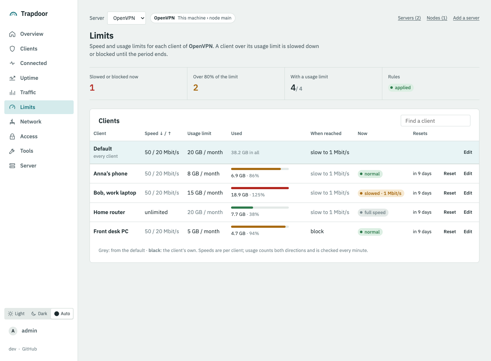

**Limits.** How fast each client may go and how much it may use: full speed until a usage
limit, then slowed down or blocked until the day, week or month ends.

## Limits page

Menu → *Limits*, for OpenVPN, WireGuard and AmneziaWG servers:

- **Defaults for every client**: download and upload speed (Mbit/s, empty = unlimited), a usage
  limit in GB per day, week (from Monday) or month, and what happens when it is reached:
  **slowed down** (1 Mbit/s by default) or **blocked** (still connected, nothing gets through).
- **Own values per client**: for speed, usage limit and "when reached", the default or its own
  (e.g. a router without a speed limit, a guest with 5 GB a month).
- **Usage** this period as a bar (orange over 80%, red over the limit), when it resets, and
  **Reset**: the client counts from zero for the rest of the period.
- **Messages** at 80% and 100% (once per period) to the admins by email and Telegram; turn
  them on or off with *a client reaches 80% or 100% of its usage limit* in their settings.

## How it works

- Every minute the web part works out each client's speed from its limits and the traffic
  history, and sends it to the agent. The agent renders `tc` commands (an HTB class per
  limited client for downloads, an IFB device for uploads) and, in Docker, the vpn container
  applies them while the interface is up, again after a restart. Unlimited clients pass
  untouched. *Rules* on the page shows whether they are applied.
- OpenVPN clients are matched by their fixed address, or their address while connected;
  WireGuard clients by theirs. IPv4.
- Tested with real traffic: the e2e test measures 1 MB through OpenVPN at 2 Mbit/s each way
  and a client blocked over a 1 MB limit.

## Upgrading from 0.6

`docker compose pull && docker compose up -d`. The vpn containers need the new image too (they
apply the speed rules), so their clients reconnect once. Nothing is limited until you set
limits. The host's kernel needs `sch_htb`, `cls_u32`, `act_mirred`, `sch_ingress` and `ifb`,
which usual distribution kernels load by themselves.
