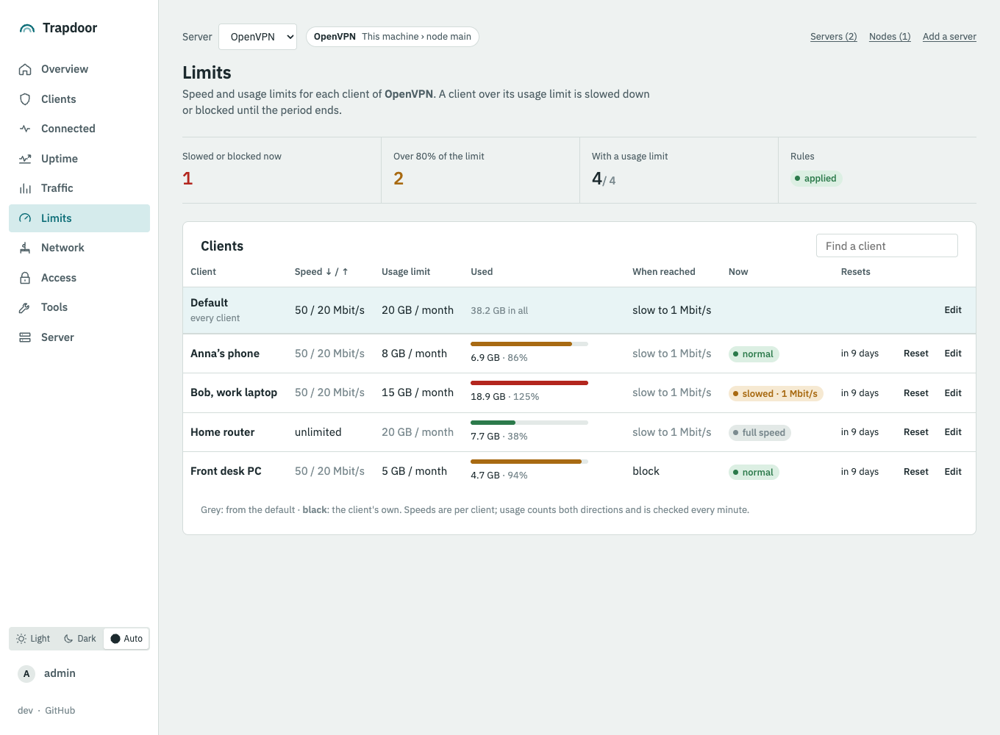

**Limits as one list.** The Limits page reads like the Clients page.

- **The default is the first row** of the list, then every client with its speed, usage
  limit, usage this period (bar and %), what happens when the limit is reached, its state now
  (normal, slowed, blocked, full speed) and when the period resets.
- **Grey values come from the default, black ones are the client's own**, so you see at a
  glance who has settings of its own.
- **A click on a row opens its dialog** (as on the Clients page); *Reset* stays in the row.
- **Phones**: one line per client with its state and usage bar; a tap opens the dialog.

## Upgrading from 0.7.0

`docker compose pull && docker compose up -d web`: only the web UI changed.
