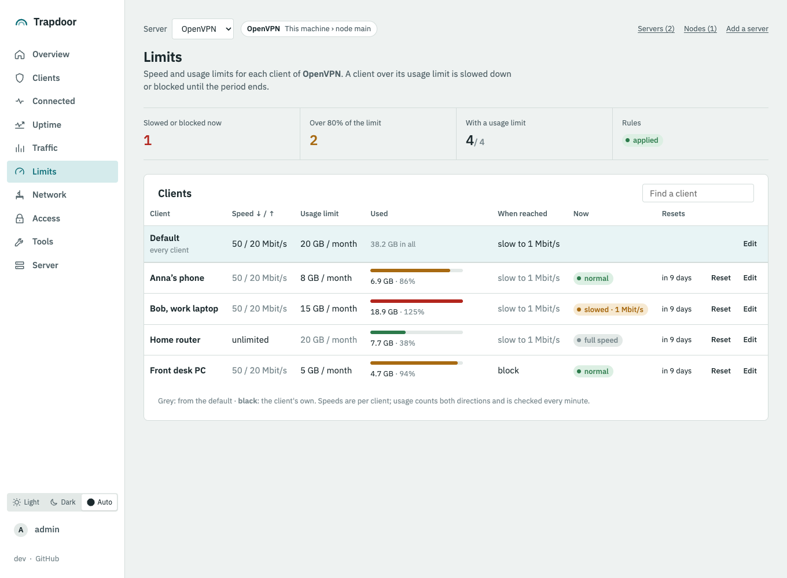

**Channels and sign-in.** Priorities, traffic alarms and the cost of traffic on the Limits
page, and signing in with Authelia.

## Limits: priorities, alarms, cost

- **Priority per client**: high, normal or low. When the server's link is busy, high goes first
  and low gets what is left; every client keeps a guaranteed share. It needs the server's
  **link speed** (Limits → *Server settings*), set a little below the real bottleneck:
  priorities only work where a queue forms.
- **Traffic alarms per server**: GB per hour, per day and / or per month; a message at 80% and
  100% by email and Telegram, once per period. Nothing is slowed: they are there to notice,
  e.g., a forgotten camera stream before it costs money.
- **Price of traffic**: per GB in and out, and the currency. This month's cost and where it ends
  up at this rate, on the Limits page and the server's **Overview**, and each client's on its
  row.
- Hints next to the speeds on how fast each VPN type usually goes (OpenVPN one process, about
  100–500 Mbit/s; WireGuard in the kernel; AmneziaWG in userspace).
- Tested with real traffic: 1 MB kept under a 4 Mbit/s link, the high-priority class in the
  kernel; WireGuard speed limits and the slow-down over a usage limit are measured too.

## Sign in with Authelia

- **Sign in with Authelia** (or another OpenID Connect provider) next to the admin password. It
  signs in as the local admin, only for members of the allowed groups (`TD_OIDC_GROUPS`,
  default `admin`); there are no separate users.
- PKCE, state and nonce, the ID token's signature and claims checked, userinfo read for the
  groups. stdlib only.
- **The admin password only from your networks** (`TD_PASSWORD_LOGIN_FROM`): from elsewhere the
  login page shows only *Sign in with Authelia*.
- **Authelia behind Cloudflare on the same machine**: Cloudflare's bot protection challenges the
  server's own call to Authelia. Route it through the reverse proxy (`extra_hosts`) and trust
  the proxy's certificate (`TD_OIDC_CA_FILE`). trapdoor names itself (`trapdoor/<version>`) and
  its log says who refused a sign-in and why.
- Step by step, with an Authelia client example and a troubleshooting table:
  [docs/oidc.md](https://github.com/shuricksumy/trapdoor/blob/main/docs/oidc.md).

## Upgrading from 0.7

`docker compose pull && docker compose up -d`. Nothing changes until you set it up: priorities
need the link speed, alarms and prices are empty, sign-in with Authelia needs `TD_OIDC_ISSUER`
and the password works from anywhere unless `TD_PASSWORD_LOGIN_FROM` is set.
